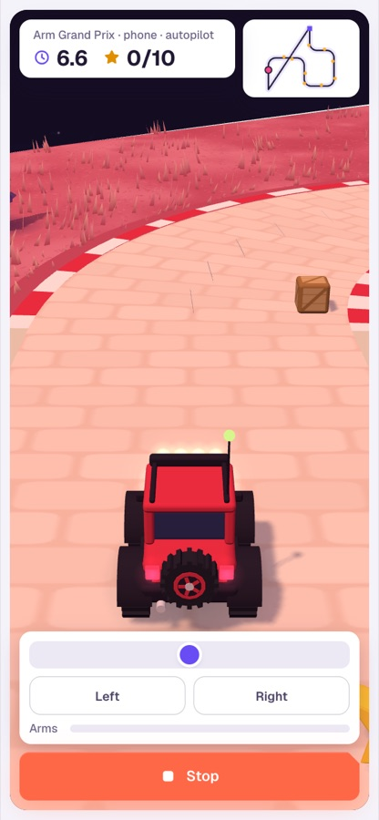

# RC-Rehab

**Flex both biceps and a real RC car takes off across the floor. On screen, your race car takes off with it.** RC-Rehab is a racing game built around a question: for a kid practising a movement at home, what makes the next repetition worth doing?

[Watch the muscle-controlled car](https://youtu.be/MJj3O7IUdX8) · [Try Arm Path](https://rc-rehab.vercel.app/arms) · [Race with your webcam](https://rc-rehab.vercel.app)



## Why a race?

One detail from a cerebral palsy study stayed with us. After six weeks with an electrical-stimulation-assisted hand game, one child reported being able to hold a toy lightsaber with his affected hand for the first time. He had spent nearly 43 hours playing. The lightsaber gave those hours a meaning that a repetition count alone couldn't convey. [Fu et al., 2020](https://pmc.ncbi.nlm.nih.gov/articles/PMC7364443/)

We chose a toy car for the same reason. In a lesson, a gate blocks the road. Squeeze when prompted and it lifts. Another gate asks you to let go. By the finish line, the player has had ten opportunities to practise, each with an outcome they can see. Our next step is to test the prototype with children with cerebral palsy and their physiotherapists. [Research behind the design](docs/design-research.md)

## From the workbench to the starting line

Our first forearm setup sometimes read **4,095 at rest**. Wiggling a jumper could change the reading before anyone moved a muscle. We resoldered the headers, moved the sensors to the biceps, and tested each arm against a single wheel. That gave us a simple debugging question at every step: when the arm relaxes, does the wheel stop?

Each MyoWare sensor now sends its envelope signal to one ESP32-S3. The browser receives both readings over Bluetooth, detects a flex, and sends a wheel-button command back to the board. The ESP32 closes the corresponding contact on the original RC remote. The car still responds to its own radio.

| From rest, the player… | The car… |
|---|---|
| Flexes the left bicep | Turns right on its left wheels |
| Flexes the right bicep | Turns left on its right wheels |
| Flexes both | Drives straight |
| Relaxes both | Stops |

We learned one more thing by driving it: two arms rarely let go at exactly the same instant. In the Arm Grand Prix, a brief dropout on one side keeps the car going straight. Both arms relaxing ends the move. An eight-second limit also stops the car and requires a fresh rest.

## What we built it with

| Layer | Hardware and software |
|---|---|
| On the player | **2 MyoWare 2.0 EMG sensors**, one per bicep, with adhesive electrodes. Left ENV goes to GPIO2 and right ENV to GPIO8 on the **ESP32-S3**. |
| On the workbench | **Arduino Uno R3** and ESP32 development boards for prototyping, jumper wires, pin headers, solder, and capacitors. The final Bluetooth rig uses one ESP32-S3 for both sensing and wheel control. |
| On the floor | A stunt RC car, its four-button remote, soldered button leads, and batteries. A separate battery bank powers the wearable rig. |
| In the browser | **JavaScript, Three.js, and Web Bluetooth** for racing with the arm sensors. The camera path uses **MediaPipe Face Landmarker** for head steering and facial gestures. |
| Behind the race | **Node.js, Express, and WebSockets** for live races and the spectator screen. The hosted version uses **Vercel and Upstash Redis** for shared state and results. |

## Take a lap

- **With just a keyboard:** open Arm Path and use **A / D** or the on-screen arm buttons. [Play Arm Path](https://rc-rehab.vercel.app/arms)
- **With a webcam:** enter the Arcade, choose a name, and follow the prompts to set your steering and go gesture. [Enter the Arcade](https://rc-rehab.vercel.app/)
- **With the car:** open Arm Path in Chrome or Edge, select **Connect MuscleCar**, and pair with **Forearm-EMG**. Check each arm, enable the real car, and start the race. [Firmware](firmware/MuscleCar/MuscleCar.ino) · [Arm setup](docs/arm-path.md)

## Run it locally

```sh
npm ci
npm start
```

Open [localhost:3000/arms](http://localhost:3000/arms) to drive or [the spectator screen](http://localhost:3000/screen) to watch. Run `npm test` for the simulator and integration checks.

For deployment, Wi-Fi firmware, and troubleshooting, see the [technical guide](docs/technical-guide.md). For bench testing, run `python3 arm-lab/serve.py` and open [Free Flex](http://127.0.0.1:8741/blind.html). It exports timestamped sensor readings and wheel commands in the [game replay format](docs/game-replay-guide.txt).
